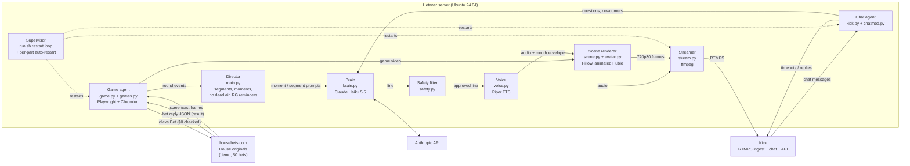

# Agents and tools

**Round flow:** the game agent checks the bet is $0, clicks Bet, and reads the result from the site's own reply.
The director decides if the round is a *moment* (streak, big hit, drought, milestone). Only then does the brain
write a line, which must pass the safety filter before Hubie says it.

**Chat flow:** messages are moderated first (links, promo spam, slurs, spam), then answered in text. Only
first-time chatters and real questions get a spoken reply, rate-limited so the game stays the focus.

**Recovery:** ffmpeg, the game browser and the chat reader each restart on failure; a game that fails 3 times in
a row is benched for an hour; `run.sh` restarts the whole app if it exits.
